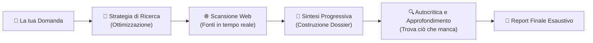

# 🐕 Info Segugio - Assistente Intelligente di Ricerca Web

**Info Segugio** è un'applicazione innovativa progettata per trasformare il modo in cui ricerchi e sintetizzi le informazioni dal web. A differenza dei comuni chatbot che si limitano a rispondere sulla base delle proprie conoscenze pregresse, Info Segugio agisce come un vero e proprio **ricercatore digitale autonomo**: esplora il web in tempo reale, seleziona fonti autorevoli, sintetizza i contenuti e approfondisce criticamente le lacune fino a consegnarti un dossier completo e affidabile.

---

## 🚀 Parte 1: Guida all'Installazione e all'Avvio

### 1.1 Prerequisiti
- **Python**: versione `>= 3.13` installata sul sistema
- **Poetry**: strumento per la gestione dell'ambiente e delle dipendenze
- **Chiave API Tavily**: per abilitare le ricerche web in tempo reale (ottenibile gratuitamente su [tavily.com](https://tavily.com))
- *(Opzionale)* **Ollama**: per eseguire l'applicazione interamente in locale e a costo zero sul proprio computer

---

### 1.2 Installazione Rapida

1. Apri il terminale e posizionati nella cartella dell'applicazione:
   ```bash
   cd info_segugio
   ```

2. Installa le librerie e i componenti necessari:
   ```bash
   poetry install
   ```

---

### 1.3 Configurazione del Servizio (`.env`)

Crea il tuo file di configurazione copiando il modello di esempio:
```bash
copy .env.example .env
```

All'interno del file `.env` puoi impostare con quale "motore" di intelligenza artificiale far lavorare il tuo assistente:

```env
# Scegli la modalità desiderata: "ollama" (in locale) oppure "openai" (nel cloud)
AI_PROVIDER=ollama

# Se usi OpenAI (Cloud - veloce e performante)
OPENAI_API_KEY=inserisci_qui_la_tua_chiave_openai
OPENAI_MODEL=gpt-4o-mini

# Se usi Ollama (Locale - gratuito e privato)
OLLAMA_API_URL=http://localhost:11434/v1
OLLAMA_MODEL=lfm3:latest

# Chiave per la Ricerca Web Tavily (obbligatoria)
TAVILY_API_KEY=inserisci_qui_la_tua_chiave_tavily
```

---

### 1.4 Avvio dell'Applicazione

Avvia Info Segugio con il seguente comando:
```bash
poetry run chainlit run src/info_segugio/__init__.py -w
```

Una volta avviato, l'interfaccia si aprirà automaticamente nel tuo browser (oppure collegati a **`http://localhost:8000`**).

---

## 💡 Parte 2: Come Funziona il Sistema (Guida per l'Utente)

Info Segugio non fornisce risposte approssimative: adotta un metodo di **indagine investigativa a più passaggi**, visualizzato in tempo reale direttamente nella chat.

---

### 2.1 Il Flusso di Lavoro: Dall'Input alla Risposta



---

### 2.2 Il "Cervello" del Sistema: La Gestione Intelligente dei Prompt

Per garantire risposte accurate, professionali e sempre in lingua italiana, Info Segugio orchestra l'Intelligenza Artificiale assegnandole **ruoli specializzati** in ogni fase, guidati da direttive rigorose:

1. **Il Prompt di Strategia (Pianificatore di Ricerca)**:
   - Non invia al motore di ricerca la frase grezza digitata dall'utente, ma la interpreta, isola le parole chiave più efficaci e definisce un angolo di indagine prioritario.
   - Fornisce all'utente una spiegazione trasparente del perché ha scelto quella specifica impostazione.

2. **Il Prompt di Sintesi (Redattore del Dossier)**:
   - Ha il compito di leggere i testi estratti dalle pagine web, selezionare solo le informazioni pertinenti ed eliminare il "rumore" o le pubblicità.
   - Man mano che l'indagine avanza, questo prompt riceve il riassunto precedente e le nuove scoperte, integrandole in modo fluido senza ripetizioni e mantenendo uno stile oggettivo ed elegante.

3. **Il Prompt di Riflessione (Il Critico Investigativo)**:
   - È il vero tocco distintivo di Info Segugio. L'AI esamina il proprio stesso riassunto e si pone una domanda fondamentale: *"Quali informazioni cruciali mancano ancora per dare una risposta completa al cliente?"*.
   - Rileva gli aspetti non ancora approfonditi e genera una nuova domanda autonoma per esplorare il web su dettagli specifici.

---

### 2.3 Le Fasi dell'Indagine Spiegate Semplice

#### 1. Comprensione della Richiesta
Appena scrivi un quesito (ad esempio: *"Qual è l'impatto economico della transizione alle energie rinnovabili?"*), il sistema lo analizza e crea una chiave di ricerca ad alta precisione, comunicandoti subito su quale aspetto si concentrerà.

#### 2. Raccolta delle Fonti dal Web
Il Segugio interroga il web in tempo reale, estraendo solo articoli, studi e notizie pertinenti da fonti affidabili. Tutte le fonti individuate (con relativi titoli e link) vengono mostrate chiaramente nella chat, offrendo totale trasparenza e verificabilità.

#### 3. Elaborazione della Sintesi
Le informazioni raccolte vengono elaborate in un primo testo chiaro e strutturato. Se l'indagine richiede ulteriori approfondimenti, i nuovi dati vengono aggiunti ai precedenti, costruendo un quadro sempre più ricco.

#### 4. Autocritica e Cicli di Approfondimento
Il sistema non si accontenta del primo risultato: analizza i punti deboli del riassunto, formula una domanda di approfondimento e avvia una nuova ricerca mirata. Questo ciclo viene ripetuto fino a 4 volte per coprire ogni sfaccettatura del tema.

#### 5. Consegna del Report Finale
Al termine dei cicli di ricerca, Info Segugio ti consegna la **risposta conclusiva**: un testo armonico, dettagliato, privo di allucinazioni e arricchito dai dati aggiornati reperiti durante l'intera sessione.

---

### 2.4 Trasparenza, Sicurezza e Comfort Visivo

- **Zero "Scatola Nera"**: Ogni decisione, fonte trovata e riflessione intermedia è visibile in chat in tempo reale. Sai sempre da dove provengono i dati.
- **Interfaccia Grafica Professionale**: Dotata di logo e avatar personalizzati di Info Segugio, con supporto nativo sia per il **Tema Scuro** (Dark Mode per lavorare confortevolmente la sera) sia per il **Tema Chiaro** (Light Mode), con passaggio automatico in base alle impostazioni del tuo dispositivo.
- **Affidabilità Garantita**: Il sistema è progettato per operare in modo asincrono, evitando blocchi visivi o disconnessioni durante le analisi più complesse.
